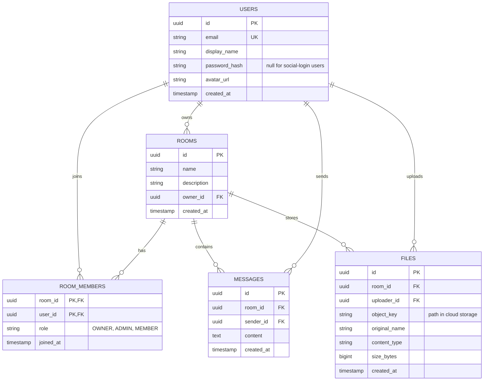
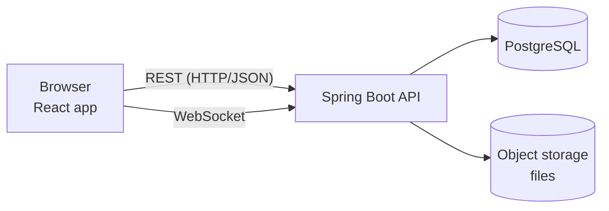
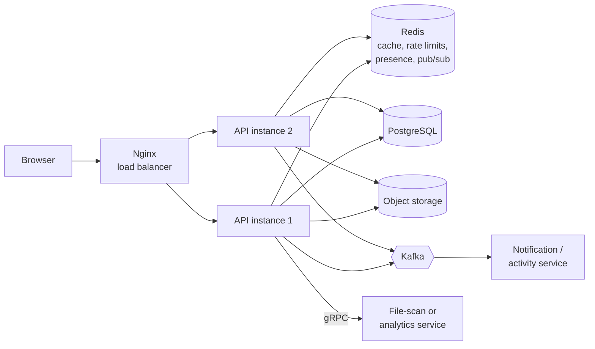

# Hive Architecture

> Living document. Last updated: Phase 0.

## 1. Problem and users

**Problem:** Small teams and study groups juggle chat apps, file-sharing
tools, and "who's online?" guesswork across different places.

**Primary user:** A member of a small team (5-50 people) who wants one place
to talk, share files, and see who's around.

**Secondary user:** A room owner who creates the room and manages members.

## 2. MVP scope

### Functional requirements (v1)

- FR1: A user can register and log in with email and password.
- FR2: A logged-in user can create a room and become its owner.
- FR3: A user can join a room and see its member list.
- FR4: Members can send and read messages in real time.
- FR5: Members can upload files to a room and download them.
- FR6: Members can see who is currently online in a room.

### Non-functional requirements

| ID | Requirement | Why it matters |
|---|---|---|
| NFR1 | A sent message reaches online members in < 500 ms | Chat must feel instant |
| NFR2 | Passwords are never stored in plain text | Security basics |
| NFR3 | Users can't read rooms they don't belong to | Privacy / authorization |
| NFR4 | API abuse is rate limited | Protects the free-tier servers |
| NFR5 | The app can run as multiple backend copies | Lets us scale later |
| NFR6 | Total hosting cost is $0 | Project constraint |

### Non-goals (for now)

- Video or voice calls
- Direct messages between two users (rooms only)
- Message threads and reactions
- A native mobile app
- Handling millions of users (we design so we *could*, but don't build for it)

## 3. Core data model

### Data decisions

- **UUID primary keys:** safe to expose in URLs (no guessable `/rooms/1`, `/rooms/2`) and can be generated without asking the database.
- **`room_members` is a join table** with a composite key (`room_id`, `user_id`) and a `role` column.
- **Files store metadata only.** The bytes live in object storage; the DB holds the `object_key` that points to them.
- **`password_hash` is nullable:** social-login users won't have a password.
- **Timestamps in UTC.** Convert to local time only in the UI.

## 4. System overview

### Phase 1 shape: a simple monolith

### Planned evolution (added only when a problem appears)

## 5. Decisions log

| # | Decision | Alternatives | Why |
|---|---|---|---|
| D1 | Monorepo | One repo per service | One developer; atomic cross-stack changes |
| D2 | Start as a monolith | Microservices from day one | Simpler to build, debug, and deploy; split only when it hurts |
| D3 | PostgreSQL | MySQL, MongoDB | Relational data, strong consistency, free hosted options |
| D4 | JWT + refresh tokens | Server sessions | Stateless; helps horizontal scaling (details in Phase 4) |
| D5 | Object storage for files | Files on API disk | API servers must stay disposable and stateless |

## 6. Glossary

- **Room:** a named space with members, messages, and files.
- **Member:** a user who belongs to a room, with a role.
- **Presence:** whether a user is currently online.